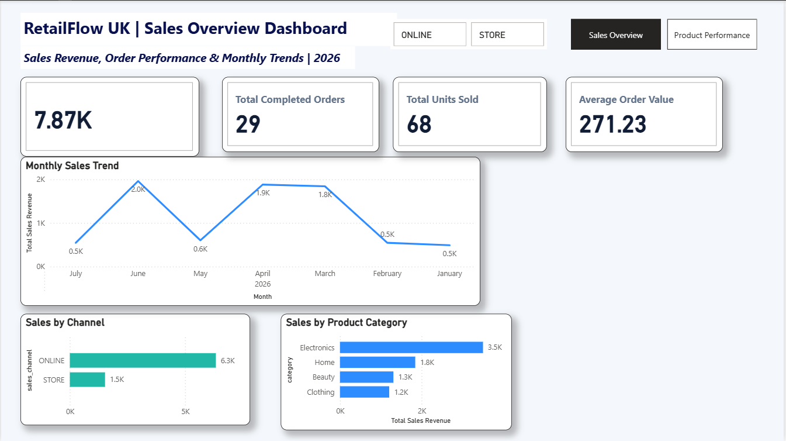
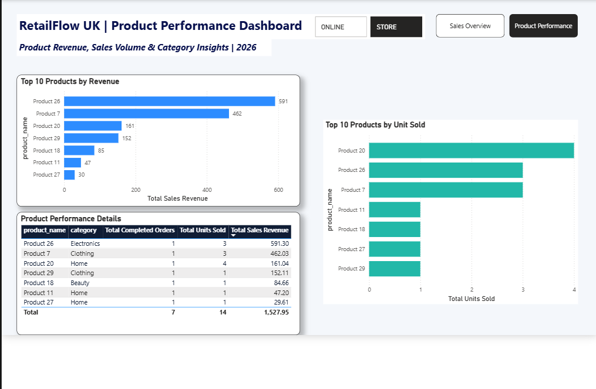

# RetailFlow UK — Azure Data Engineering & Analytics

An end-to-end Azure Data Engineering and Business
Intelligence portfolio project that transforms raw
retail data into validated, business-ready analytics.

## Project Overview

RetailFlow UK demonstrates a Medallion Architecture
using Azure Data Lake Storage Gen2, Azure Synapse
Analytics Serverless SQL, and Microsoft Power BI.

The solution processes customer, product and order
datasets through Bronze, Silver and Gold SQL layers.

## Technology Stack

- Azure Data Lake Storage Gen2
- Azure Synapse Analytics Serverless SQL
- T-SQL
- Microsoft Power BI Desktop
- GitHub

## Solution Architecture

Retail CSV Data
    |
    v
Azure Data Lake Storage Gen2
    |
    v
Bronze — Raw Data (3 Views)
    |
    v
Silver — Data Quality (8 Views)
    |
    v
Gold — Business Analytics (9 Views)
    |
    v
Power BI Dashboards

[View Architecture Diagram](docs/architecture-diagram.md)

[Read Architecture Documentation](docs/architecture.md)

## Data Engineering Implementation

### Bronze Layer

Created SQL views to access raw customer, product
and order datasets stored in ADLS Gen2.

### Silver Layer

Implemented SQL transformations covering:

- Data standardization
- Duplicate detection and removal
- Product price enrichment
- Transaction validation
- Rejected record classification
- Referential integrity checks
- Reporting eligibility classification

### Gold Layer

Developed business-ready SQL views for:

- Sales reporting fact
- Product dimension
- Revenue and order KPIs
- Sales channel performance
- Channel revenue contribution
- Product revenue and sales volume
- Category performance
- Monthly sales trends

[Explore SQL Documentation](sql/README.md)

## Data Quality Results

| Metric | Records |
|---|---:|
| Raw Orders | 302 |
| Duplicate Orders Removed | 2 |
| Unique Orders | 300 |
| Core-valid Orders | 205 |
| Rejected Orders | 95 |
| Reporting Ready | 29 |
| Requires Review | 176 |

## Business Intelligence Results

| KPI | Value |
|---|---:|
| Total Sales Revenue | £7,865.75 |
| Completed Orders | 29 |
| Total Units Sold | 68 |
| Average Order Value | £271.23 |

### Sales Overview Dashboard



The dashboard presents sales revenue, order KPIs,
monthly trends, channel performance and category
contribution.

### Product Performance Dashboard



The dashboard provides product-level revenue,
sales volume, product rankings and detailed
performance analysis.

The screenshot illustrates the STORE channel
selection.

## Project Structure

```text
retailflow-uk-azure-data-engineering/
|
|-- sql/
|   |-- bronze/
|   |-- silver/
|   |-- gold/
|   |-- README.md
|
|-- docs/
|   |-- architecture.md
|   |-- architecture-diagram.md
|
|-- images/
|   |-- sales-overview.png
|   |-- product-performance.png
|
|-- README.md
```

## Key Skills Demonstrated

- Azure cloud data engineering
- Data Lake Storage integration
- Medallion Architecture
- Serverless SQL development
- Data cleansing and validation
- Data quality management
- Dimensional modelling
- Analytical SQL aggregations
- Power BI data modelling and visualisation
- Technical documentation

## Future Enhancements

Potential improvements include:

- Azure Data Factory orchestration
- Automated data quality monitoring
- Incremental processing
- CI/CD integration
- Pipeline monitoring and alerting

## Dynamic Record-Count Validation

The RetailFlow UK pipeline implements dynamic source-to-destination record-count validation using Azure Data Factory and Azure Synapse Serverless SQL.

### Implementation

- Retrieves the number of source records from the Copy activity's `rowsRead` output.
- Independently counts destination Parquet records using a Synapse SQL `OPENROWSET` query.
- Dynamically compares source and destination record counts using an ADF If Condition activity.
- Records successful validation through a pipeline variable.
- Automatically fails the pipeline when a record-count mismatch occurs.
- Generates dynamic error messages containing expected and actual record counts.

### Validation Expression

```text
@equals(int(activity('Lookup_Orders_Parquet_Count').output.firstRow.TotalRecords), int(activity('Copy_Bronze_Orders_To_Parquet').output.rowsRead))
```

### Test Results

| Metric | Result |
|---|---|
| Source records read | 302 |
| Records copied | 302 |
| Destination Parquet records | 302 |
| Dynamic validation | Passed |
| Successful activities | 7/7 |
| Pipeline deployment | Published |

### Business and Technical Benefits

- Eliminates hardcoded record-count thresholds.
- Accommodates datasets of varying sizes.
- Improves pipeline reliability and data integrity.
- Simplifies troubleshooting through detailed error messages.
- Supports reusable data ingestion patterns.

### Testing Scope

Successful execution has been verified against the existing dataset of 302 records. Testing alternative dataset sizes and intentional record-count mismatches remains a future enhancement.
