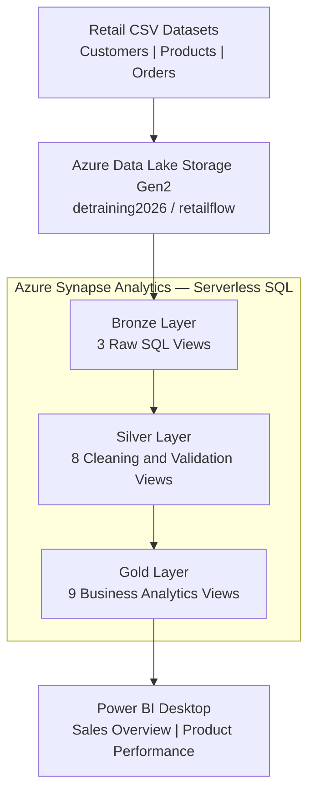

# RetailFlow UK — Architecture Diagram

## Architecture Summary

RetailFlow UK uses Azure Data Lake Storage Gen2
for source data storage, Azure Synapse Analytics
Serverless SQL for data transformation, and
Power BI for business intelligence reporting.

The Medallion Architecture separates raw data
access, data quality processing and business
analytics into Bronze, Silver and Gold layers.
